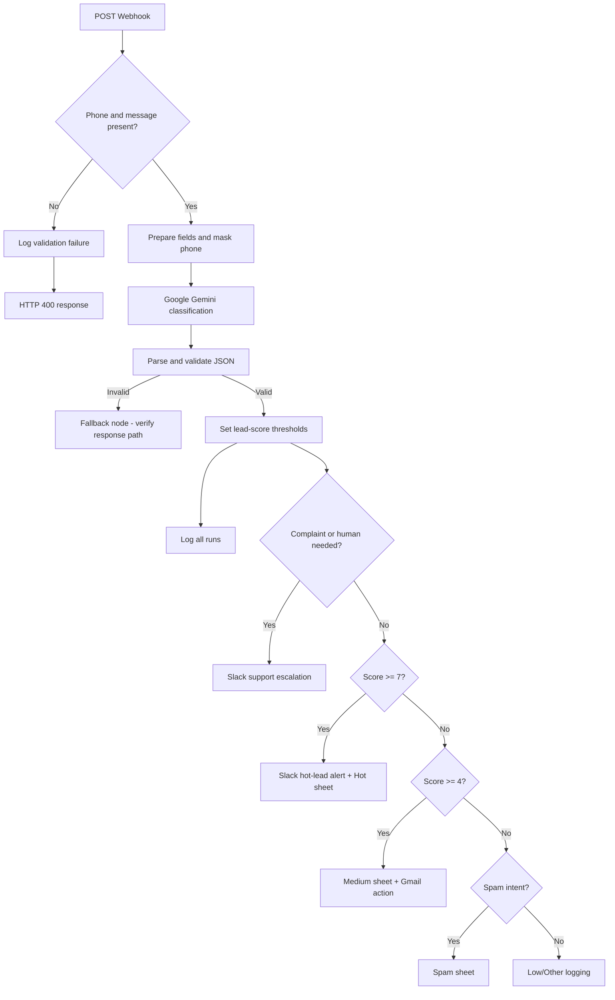

# Course Inquiry AI Triage and Lead Routing

An n8n workflow that receives course inquiries through a secured webhook, uses Google Gemini to classify and summarize each message, scores lead quality, and routes inquiries to the relevant operational path.

> **Portfolio note:** The supplied workflow title mentions Claude, but the exported node uses **Google Gemini** (`models/gemini-3-flash-preview`). This repository documents the implementation shown in the JSON, not a Claude integration.

## What it does

- Accepts `POST` requests at an n8n webhook endpoint.
- Validates that `phone` and `message` are present.
- Masks the phone number before sending the prepared record to the model.
- Uses Gemini to classify intent as `price`, `schedule`, `job_placement`, `complaint`, `spam`, or `other`.
- Requests a 1–10 lead score, language label (`bn`, `en`, `mixed`), one-line summary, suggested Bangla reply, and human-review flag.
- Parses and validates the model's JSON response.
- Uses configurable score thresholds: hot lead `>= 7`, medium lead `>= 4`.
- Writes inquiry information to Google Sheets and sends Slack alerts for support escalations and hot leads.
- Includes a Gmail action on the medium-lead path. Verify the Gmail node's operation in your n8n instance before assuming it creates a draft; the exported parameters alone do not prove draft behavior.

## Workflow overview



Editable Mermaid source: [`docs/workflow-diagram.mmd`](docs/workflow-diagram.mmd)

## Business use case

Education and training providers often receive course questions across forms and landing pages. Staff may need to read each message, identify the topic, decide urgency, prepare a response, and notify the right teammate.

This workflow is designed to support that process by:
- separating likely high-intent leads from lower-priority inquiries;
- surfacing complaints and cases requiring staff attention in Slack;
- recording structured inquiry data for follow-up and review;
- generating a suggested Bangla response for staff to review.

It is a triage assistant, not a replacement for human review. The suggested reply should be checked against the provider's current fees, schedule, policies, and course details before it is sent.

## Stack

- n8n
- Google Gemini node
- Google Sheets
- Slack
- Gmail
- Webhook / HTTP POST
- JavaScript Code node for JSON parsing and validation

## Input contract

Send JSON to the webhook with these fields:

```json
{
  "name": "Sample Learner",
  "email": "learner@example.com",
  "phone": "+8801712345678",
  "course_interest": "Digital Marketing",
  "message": "কোর্সের ফি কত এবং কিস্তিতে দেওয়া যাবে কি?"
}
```

`phone` and `message` are required by the current validation node. Other fields should be supplied for useful downstream output. In particular, the medium-lead Gmail path expects a usable email address.

## Example output shape

The model is instructed to return a structured object similar to this. This is an **illustrative example**, not a captured execution result:

```json
{
  "intent": "price",
  "lead_score": 8,
  "language": "bn",
  "summary": "The learner asks about course fees and installment options.",
  "suggested_reply": "কোর্সের ফি ও পেমেন্টের বিকল্প সম্পর্কে বিস্তারিত জানাতে আমাদের টিমের সঙ্গে যোগাযোগ করুন।",
  "needs_human": false
}
```

The final parsed item also includes the inquiry fields and masked phone value.

## Setup guide

### Prerequisites

- An n8n instance with the node types used by this workflow available.
- A Google Gemini API credential.
- A Google Sheets OAuth credential and a spreadsheet with the required tabs/columns.
- A Slack credential and channel IDs for support escalation and hot-lead alerts.
- A Gmail credential if you intend to use the medium-lead email action.
- A test endpoint/client capable of sending JSON by HTTP POST.

### Import and configure

1. Import `workflow/course-inquiry-ai-triage.template.json` into a test n8n workspace.
2. Open every Google Sheets node and select your own spreadsheet and target tab. The template replaces the original spreadsheet ID with `REPLACE_WITH_YOUR_GOOGLE_SHEET_ID`.
3. Connect your own Google Gemini credential to the Gemini node.
4. Connect your own Slack credential and choose the correct channels for support escalation and hot-lead alerts.
5. Connect your own Gmail credential, then inspect the Gmail node's resource/operation. Confirm whether it sends an email or creates a draft before enabling it.
6. Configure the Webhook Header Auth credential. Do not expose the webhook without authentication.
7. Review the Code node's error output and the `Fallback Response` node. Ensure model parsing failures produce a deliberate HTTP response and are logged.
8. Check every Google Sheets column mapping, especially `Log Low Other Inquiry`, whose exported mapping is empty.
9. Run the test checklist below using fake data before enabling production traffic.
10. Use n8n's **Test URL** while testing. Switch to the **Production URL** only after the workflow is active and all integrations have been verified.

### Example request

Replace the URL and header name/value with your own n8n webhook URL and Header Auth configuration.

```bash
curl -X POST "https://YOUR_N8N_HOST/webhook/course-inquiry" \
  -H "Content-Type: application/json" \
  -H "YOUR_AUTH_HEADER: YOUR_SECRET_VALUE" \
  -d '{
    "name": "Sample Learner",
    "email": "learner@example.com",
    "phone": "+8801712345678",
    "course_interest": "Digital Marketing",
    "message": "কোর্সের ফি কত?"
  }'
```

Never commit real API keys, OAuth tokens, webhook secrets, customer data, or private spreadsheet URLs to GitHub.

## Output and evidence

The workflow's main evidence should be collected from real test executions:
1. **n8n execution:** capture the successful node path and parsed output.
2. **Google Sheets:** capture one sanitized row from each tested route.
3. **Slack:** capture a fake hot-lead alert and a fake support escalation.
4. **Gmail:** capture the actual result after confirming whether the node sends or drafts.
5. **HTTP response:** capture both a valid request and a missing-field request.

Before publishing screenshots, blur names, email addresses, phone numbers, webhook URLs, channel IDs, spreadsheet IDs, and credentials. Do not present illustrative JSON as a real execution screenshot.

## Test checklist

See [`docs/test-plan.md`](docs/test-plan.md). At minimum, test:
- valid hot lead (score 7–10);
- medium lead (score 4–6);
- low/other inquiry (score 1–3);
- spam;
- complaint or `needs_human: true`;
- missing phone;
- missing message;
- invalid/empty model output;
- missing or invalid email on the medium path;
- Google Sheets, Slack, and Gmail credential failures.

## Business impact measurement

Do not claim a fixed time saving until measured. For a small pilot:
1. Track how long staff spend manually triaging a sample of inquiries before automation.
2. Track how much review time remains after automation.
3. Record total inquiries, route accuracy, human corrections, failed runs, and response turnaround.
4. Compare the same metrics over a representative period.

Suggested metrics:
- **Minutes saved** = manual handling time before automation − human review time after automation.
- **Routing accuracy** = correctly routed test inquiries ÷ total reviewed test inquiries.
- **Escalation precision** = true escalations ÷ all escalations sent.
- **Failure rate** = failed executions ÷ total executions.
- **Time to first response** = time received to first human-approved response.

Use a labeled test set and report the sample size and measurement period when sharing results.

## Known issues to verify before production

These findings are based on inspection of the exported JSON; the workflow has not been executed in this environment.

1. **Naming mismatch:** the original filename says Claude, while the actual model node is Google Gemini.
2. **Fallback response path:** the Code node's error output connects to `Fallback Response`, but that node is not connected to a `Respond to Webhook` node. Confirm that clients receive a defined error response when parsing fails.
3. **Low/Other mapping:** `Log Low Other Inquiry` has an empty `columns.value` mapping in the export. Configure the expected columns before relying on it.
4. **Gmail behavior:** the node is named “Create Medium Lead Gmail Draft,” but verify the selected Gmail operation in n8n; the export's visible parameters are not enough to confirm draft-vs-send behavior.
5. **Support escalation logging:** support escalations go to Slack while the all-runs logging node runs in parallel. Confirm the route value and execution behavior in a live test.
6. **Validation coverage:** only phone and message are required in the current IF node. Validate email before any email action, and consider normalizing/validating phone and message length.
7. **Privacy:** phone masking is applied in the prepared input, but name, email, and message are still sent to the model and logged. Review consent, data retention, access control, and the minimum data the model needs.
8. **Webhook response on success:** the export uses `responseMode: responseNode`, but only the invalid-request branch visibly connects to a `Respond to Webhook` node. Add a deliberate success response for callers and test all branches.

## Repository contents

```text
.
├── README.md
├── workflow/
│   └── course-inquiry-ai-triage.template.json
├── docs/
│   ├── workflow-diagram.mmd
│   ├── test-plan.md
│   └── demo-script.md
└── examples/
    ├── sample-request.json
    └── illustrative-model-output.json
```

## License

Choose a license before inviting reuse. If this is an assignment or includes third-party assets, confirm what you are allowed to publish first.
